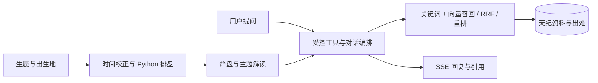

<div align="center">

# 紫微研习 · Ziwei Agent

**可追溯资料的紫微斗数排盘与 AI 问答**

[](https://www.python.org/)
[](https://fastapi.tiangolo.com/)
[](LICENSE)

[在线体验](https://lovelxr.site) · [快速开始](#快速开始) · [数据导入](docs/DATA.md) · [参与贡献](CONTRIBUTING.md)

</div>

输入生辰和出生地，查看十二宫命盘与 13 个主题解读，再围绕命盘继续提问。AI 通过受控工具读取当前命盘，结合《天纪》检索结果作答，引用可跳转到原视频对应时间。

本仓库包含前后端、数据库结构和数据导入工具；命盘解读与《天纪》语料从上游下载，不附带线上数据库、账号或密钥。

## 功能亮点

- **三种命盘视图**：三合盘、飞星盘、四化盘；支持宫位联动、生年 / 大限 / 流年四化。
- **出生时间校正**：公历与农历输入，国内省市区县选择；结合历史时区、经度和均时差计算真太阳时，保留钟表时间供核对。
- **13 维主题解读**：事业、感情、财运等主题，逐层展开原文依据。
- **带出处的 AI 对话**：Elasticsearch 关键词与 PostgreSQL 向量混合召回，经 RRF 融合和重排后提供证据。
- **可持续的会话**：SSE 流式回复、断线回放、长对话摘要、按用户隔离的历史与显式记忆。
- **命盘与会话管理**：保存、重命名和单条删除，支持桌面与移动端。

飞星、四化沿用同一本命星位并叠加四化关系；右侧静态主题仍是上游 v4 本命解读，不会随视图切换生成另一套断语。详见[排盘口径](deploy/CHART-SCHOOLS.md)。

## 快速开始

推荐 Linux / macOS / WSL，准备 Python 3.12+、[uv](https://docs.astral.sh/uv/)、Docker Compose、`psql` 和 `zstd`。

Ubuntu / Debian 可执行 `sudo apt-get install postgresql-client zstd`；macOS 可通过 Homebrew 安装 `libpq zstd`，并将 `libpq/bin` 加入 PATH。

### 1. 安装与配置

在本仓库根目录执行：

```bash
uv sync --frozen --extra test --python 3.12
cp .env.example .env
uv run python -c 'import secrets; print(secrets.token_urlsafe(48))'
```

将生成值填入 `.env` 的 `JWT_SECRET`。默认数据库连接指向下一步启动的本地服务。

| 配置 | 用途 |
| --- | --- |
| `DATABASE_URL` | PostgreSQL 连接，需支持 pgvector |
| `ELASTICSEARCH_URL` | Elasticsearch 8 地址 |
| `JWT_SECRET` | 至少 32 字符的随机签名密钥 |
| `LLM_API_KEY` / `LLM_MODEL` | OpenAI 兼容聊天接口；示例使用 DeepSeek |
| `ZHIPU_API_KEY` | 《天纪》向量生成及问答重排 |

只查看命盘与静态解读，无需模型 Key。AI 问答需要填写聊天和智谱配置，并完成向量与搜索索引初始化。

### 2. 启动数据库

```bash
docker compose -f compose.dev.yaml up -d --wait
```

开发配置只将 PostgreSQL 和 Elasticsearch 暴露到本机，数据写入 Docker 持久卷。已有服务可直接修改 `.env`，跳过此步。

### 3. 一条 SQL 入口加载数据

```bash
uv run --env-file .env sh -c 'psql "$DATABASE_URL" -X -f sql/bootstrap.sql'
```

该入口依次建表、下载并校验上游文件、导入命盘和《天纪》片段。无需手工转换文件，也无需模型 Key。**这是包含 `psql` 元命令的脚本，须在仓库根目录运行，不能直接粘贴到图形 SQL 编辑器。**

默认导入 **2000–2026 年**，解压后的文本为数十 GB，请预留数据库、临时表及 WAL 空间。可先用一个年份体验，之后重复执行补充数据：

```bash
ZIWEI_CHART_YEARS=2000 uv run --env-file .env sh -c 'psql "$DATABASE_URL" -X -f sql/bootstrap.sql'
```

已校验的压缩包会缓存在 `data/upstream/`。重复导入按主键更新，不清空用户记录。下载失败、校验失败或坏数据会使当前导入事务回滚。[完整数据说明 →](docs/DATA.md)

### 4. 初始化 AI 检索（可选）

配置 `ZHIPU_API_KEY` 后执行，向量生成会产生供应商 API 费用：

```bash
uv run --env-file .env python -m ziwei.embedding_index
uv run --env-file .env ziwei-index
```

原文与向量保存在 PostgreSQL，Elasticsearch 是可重建的关键词索引。文本不变时会复用向量，失败后可以重新运行。

### 5. 启动应用

```bash
uv run --env-file .env uvicorn ziwei.api:app --host 127.0.0.1 --port 8000
```

打开 [localhost:8000](http://localhost:8000)，接口文档在 [/docs](http://localhost:8000/docs)。出生日期须位于已导入的年份；当前应用开放范围为 2000–2026 年。

## 数据来源

| 数据 | 下载入口 | 许可 |
| --- | --- | --- |
| 命盘 13 维解读 v4.0 | [上游仓库](https://github.com/Renhuai123/ziwei-doushu) · [Release v4.0-13d](https://github.com/Renhuai123/ziwei-doushu/releases/tag/v4.0-13d) | 主体 CC BY 4.0，引用另有说明 |
| 《天纪》结构化语料 | [上游仓库](https://github.com/Renhuai123/nihai-tianji-corpus) · [JSONL 原始文件](https://raw.githubusercontent.com/Renhuai123/nihai-tianji-corpus/462faa4c70af40b8b87ad82ffa82a5823a485e94/data/entries.jsonl) | CC BY-NC-SA 4.0 |
| 国内行政区划与参考坐标 | [来源、版本和许可](src/ziwei/data/README.md) | 按各来源许可保留 |

本项目使用了紫微斗数开源解读数据集 v4.0，来源 **Renhuai123/ziwei-doushu**，作者 **王多鱼AI**。上游全量覆盖 1950–2026 年，本应用当前只接受其中 2000–2026 年。

行政区划是出生地选择器必需的离线资源，随代码保留；业务语料、向量和用户数据不随代码分发。SQL 下载器固定版本与 SHA-256，详见[数据文档](docs/DATA.md)。

## 工作原理



后端采用 FastAPI、asyncpg 和纯 Python 排盘；前端使用原生 JavaScript / CSS，无 Node 构建步骤。命盘引擎以 `iztro-py` 为基础，按固定上游版本移植规则并保留对照测试；不宣称与所有流派或其他同名库完全一致。

## 项目结构

```text
src/ziwei/       API、排盘、对话、检索与数据转换
static/         页面、宫格和交互样式
sql/            建表、兼容迁移与数据加载入口
scripts/        开发验证、参考数据生成与源码打包
tests/         单元测试及排盘对照夹具
deploy/        Nginx / systemd 示例与专题说明
docs/          数据与部署文档
```

## 开发与部署

```bash
uv run pytest tests -q
# 使用独立 schema 验证建表、重复初始化和旧库升级，结束后回滚
uv run --env-file .env python scripts/verify_sql_schema.py
```

常规测试不需要线上数据库或模型 Key。浏览器与真实模型脚本为手动检查，依赖及费用说明见[测试文档](docs/TESTING.md)。GitHub Actions 会运行单元测试并检查源码发布包。

生产部署请阅读[部署说明](docs/DEPLOYMENT.md)。`compose.dev.yaml` 用于本地依赖；现有 `compose.yaml` 保留线上入口配置，两者用途不同。

欢迎通过 Issue 报告问题、通过 PR 改进项目，流程见 [CONTRIBUTING.md](CONTRIBUTING.md)。

## 许可与致谢

项目原创代码采用 [MIT](LICENSE)，第三方代码的版权声明见 [NOTICE](NOTICE)。数据具有独立许可，尤其《天纪》语料含非商业及相同方式共享要求，不能套用代码的 MIT 授权。

感谢 [Renhuai123/ziwei-doushu](https://github.com/Renhuai123/ziwei-doushu)、[nihai-tianji-corpus](https://github.com/Renhuai123/nihai-tianji-corpus) 和 [iztro-py](https://github.com/spyfree/iztro-py) 的开放工作。

传统命理内容用于文化学习与交流，不构成科学预测，也不能替代医疗、法律或财务等专业判断。
